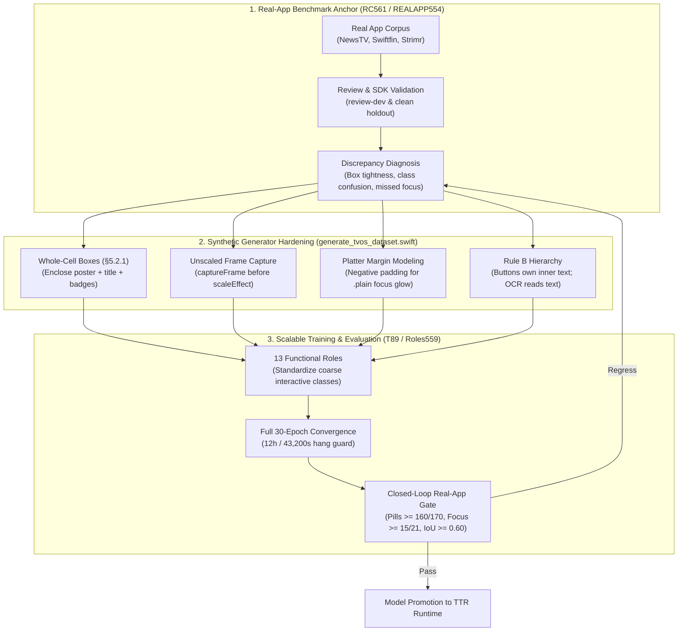

# ADR-0032 - Real-App Grounded Tuning and Synthetic Alignment for NUIAK Models

Date: 2026-11-02  
Status: Proposed; architecture decision record. [Tasks.md](file:///Volumes/training-drive/data/NUIAK/project/NativeUIAuditKit/Tasks.md) owns execution status.  
Owners: `Maximum-mini-NUIAK` owns model perception, generator alignment, and training pipelines. `Maximum-mini-TTR` and `Sillycon-TTR` own runtime environment integration and capture.  
References: [Nov2-WorkflowAnalysis.md](file:///Volumes/training-drive/data/NUIAK/project/NativeUIAuditKit/Research/Nov2-WorkflowAnalysis.md), [NativeUIElementDetection.md](file:///Volumes/training-drive/data/NUIAK/project/NativeUIAuditKit/Research/NativeUIElementDetection.md), [REALAPP554](file:///Volumes/training-drive/data/NUIAK/project/NativeUIAuditKit/Research/Plans/RealApp554.md), [ROLES559](file:///Volumes/training-drive/data/NUIAK/project/NativeUIAuditKit/Research/Plans/Roles559.md), [PILLS560](file:///Volumes/training-drive/data/NUIAK/project/NativeUIAuditKit/Research/Plans/Pills560.md), and [REALCORPUS561](file:///Volumes/training-drive/data/NUIAK/project/NativeUIAuditKit/Research/Plans/RealCorpus561.md).

---

## 1. Context

NativeUIAuditKit trains vision models to detect native Apple UI elements and visual focus states.
Earlier models trained and evaluated almost entirely on synthetic scenes generated by [generate_tvos_dataset.swift](file:///Volumes/training-drive/data/NUIAK/project/NativeUIAuditKit/scripts/generate_tvos_dataset.swift).
Those models reached validation scores above 0.98 mAP on synthetic holdout sets.
However, when the team evaluated the shipped detector on real applications in [REALAPP554](file:///Volumes/training-drive/data/NUIAK/project/NativeUIAuditKit/Research/Plans/RealApp554.md), the model failed.
On NewsTV, the detector found only 23 of 207 controls (COCO AP50 of 0.206).
Tab pills were detected only 1 out of 153 times.
The FocusRing classifier found 0 of 15 visibly focused controls.

Investigations in [REALAPP557](file:///Volumes/training-drive/data/NUIAK/project/NativeUIAuditKit/Research/Plans/RealLikeCells558.md) and [Nov2-WorkflowAnalysis.md](file:///Volumes/training-drive/data/NUIAK/project/NativeUIAuditKit/Research/Nov2-WorkflowAnalysis.md) revealed root causes:
1. **Generator Box Discrepancy**: The synthetic generator boxed artwork posters only, while real applications box whole interactive cells including titles.
2. **SwiftUI Frame Inflation**: Calling `.scaleEffect` before `.captureFrame` inflated ground-truth boxes by 6% to 10% on focused controls.
3. **Platter Boundary Mismatch**: Real tvOS `.plain` buttons draw an illumination platter outside the layout frame. Synthetic data drew platters inside the frame, teaching the model to predict oversized boxes (IoU 0.45).
4. **Class Confusion and Label Conflicts**: A 41-class taxonomy caused pills to be classified as `label` instead of `button`. Tab pills had nested text annotations, while PIN buttons had none.
5. **Training Truncation**: Arbitrary 1,800 s time limits aborted training runs before convergence.

Recent experiments in [ROLES559](file:///Volumes/training-drive/data/NUIAK/project/NativeUIAuditKit/Research/Plans/Roles559.md) and [PILLS560](file:///Volumes/training-drive/data/NUIAK/project/NativeUIAuditKit/Research/Plans/Pills560.md) proved that tuning data alignment and taxonomy produces immediate gains:
- 13 functional roles eliminated tab text misclassification.
- Modeling negative platter margins raised NewsTV pill IoU from 0.454 to 0.631.
- Pill recall rose from 27/170 to 169/170 (99.4%).
- Active focus coverage increased from 8/21 to 15/21 frames.

We need an architectural decision to formalize this tuning loop across all NUIAK model development.

---

## 2. Decision

We decide to adopt a **Closed-Loop Real-App Grounded Tuning Architecture** for all NativeUIAuditKit detector and focus models.
We will not admit or promote models based on synthetic validation metrics alone.
Real-world application benchmarks serve as the primary validation gate.
Synthetic generators are systematically aligned to match real platform geometry and styling contracts.

### 2.1. Rule 1: Real-App Grounded Evaluation as Primary Gate
1. Maintain `review-dev` (21 real application frames) for development tuning and error diagnosis.
2. Maintain an untouched, clean real-app holdout set for candidate promotion decisions.
3. Real application frames remain strictly evaluation-only.
4. Never mix real application pixels into training sets.
5. Expand real-app validation coverage to at least 8 SDK-qualified open-source applications via [REALCORPUS561](file:///Volumes/training-drive/data/NUIAK/project/NativeUIAuditKit/Research/Plans/RealCorpus561.md).

### 2.2. Rule 2: Synthetic Generator Hardening Contracts
1. **Whole-Cell Bounding Boxes (§5.2.1)**:
   All collection items, cards, and lockups must box the entire cell.
   The box must contain artwork, title text, subtitle, and badge elements.
2. **Unscaled Frame Capture**:
   Never place SwiftUI `.scaleEffect(...)` before `.captureFrame(...)`.
   Capture layout boxes on unscaled views.
   If visual focus scale is desired, render scale on an uncaptured visual layer.
3. **Realistic Platter Margins**:
   Draw `.plain` button focus platters extending beyond the layout frame with negative padding.
   Teach the detector to predict the platform layout frame rather than the expanded light platter.
4. **Rule B Button and Text Hierarchy**:
   Interactive controls own their inner text.
   Do not emit separate nested `text` or `label` boxes inside buttons, tab pills, or keypad keys.
   OCR reads text inside detected control boxes.

### 2.3. Rule 3: 13 Functional Roles Architecture
1. Transition tvOS element detection from 41 fine-grained classes to 13 functional roles ([ROLES559](file:///Volumes/training-drive/data/NUIAK/project/NativeUIAuditKit/Research/Plans/Roles559.md)).
2. Map interactive pills, tabs, and buttons to the unified `button` role.
3. Map media lockups, cards, and grid items to the unified `cell` role.
4. Fine-grained attributes (for example, tab vs. push button) are resolved downstream by metadata or OCR.

### 2.4. Rule 4: Convergent Training Policy
1. Execute all full detector and FocusRing training jobs with the 43,200 s (12 h) hang guard ([research_execution_policy.py](file:///Volumes/training-drive/data/NUIAK/project/NativeUIAuditKit/scripts/research_execution_policy.py)).
2. Allow models to train across all 30 epochs without artificial interruption.
3. Never drop epochs or shrink datasets to satisfy arbitrary timer limits.
4. Discard and prohibit synthetic stubs that mock loss curves or optimize naked coordinate tensors.

---

## 3. Environment and Ownership Boundaries

- **`Maximum-mini-NUIAK`**:
  Owns dataset generation, label contracts, training execution, and real-app benchmark scoring.
  Ensures synthetic generators adhere strictly to §5.2.1 and unscaled frame capture rules.
  Guarantees real-app frames remain quarantined from training inputs.
- **`Maximum-mini-TTR` and `Sillycon-TTR`**:
  Own device execution, Simulator state management, and real application capture.
  Ensure Simulator ports (8080) and test bridge instances clear between capture sessions.
  Maintain test profile settings to suppress system notification dialogs.

---

## 4. Consequences

### Positive Consequences
- **Direct Real-World Generalization**: Models are trained against failure patterns observed in real applications.
- **Elimination of Class Confusion**: 13 functional roles eliminate ambiguities between `label`, `secondaryButton`, and `primaryButton`.
- **Accurate Control Localization**: Removing generator frame scale defects and modeling platter margins provides high IoU (0.63+ on pills, 0.96+ on cards).
- **Stable Training Convergence**: The 12-hour guard allows complete training runs without premature timeouts.
- **Efficient Research Iteration**: Small 5-to-10 job cycles replace fragile 400-job dependency cascades.

### Negative Consequences and Tradeoffs
- **Generator Regeneration Overhead**: Updating generator geometry requires regenerating synthetic training datasets (`dataset/tvos560`).
- **Real-App Ingestion Maintenance**: Maintaining open-source app targets in [REALCORPUS561](file:///Volumes/training-drive/data/NUIAK/project/NativeUIAuditKit/Research/Plans/RealCorpus561.md) requires Xcode dependency management and SDK qualification checks.
- **Taxonomy Migration**: Consumers expecting 41 fine-grained detector classes must adapt to 13 functional roles plus OCR.

---

## 5. Rejected Alternatives

1. **Relying Exclusively on Synthetic Holdout Metrics**:
   Rejected. Synthetic holdout sets yielded 0.98 mAP while failing completely on real applications (0.206 AP50 on NewsTV).
2. **Shrinking Datasets to Fit 1,800-Second Timeouts**:
   Rejected. Caused 4 consecutive timeouts in `CELLS558` and incentivized non-functional toy stubs.
3. **Labeling Visible Focus Platters as Ground-Truth Boxes**:
   Rejected. The platform contract (§5.2.1) specifies the interactive layout frame. Boxing platters produces erratic sizes when themes or styles change.
4. **Nested Text Boxes Inside Buttons (Rule A)**:
   Rejected. In [PILLS560](file:///Volumes/training-drive/data/NUIAK/project/NativeUIAuditKit/Research/Plans/Pills560.md) R3, nested text caused mutual suppression with PIN entry buttons. Rule B cleanly assigns text ownership to buttons.

---

## 6. Implementation and Verification Plan

1. **Generator Verification**:
   Verify that [generate_tvos_dataset.swift](file:///Volumes/training-drive/data/NUIAK/project/NativeUIAuditKit/scripts/generate_tvos_dataset.swift) captures unscaled layout frames and applies platter margins.
   Audit generated labels against previous releases using `scripts/roles559_evaluate.py`.
2. **Training Verification**:
   Train detector candidates using `T89` under the 43,200 s guard.
   Confirm that all 30 epochs complete and save valid `final.pt` checkpoints.
3. **Real-App Evaluation**:
   Score trained candidates on the 21-screen `review-dev` set using `scripts/roles559_evaluate.py`.
   Require NewsTV pill recall ≥ 160/170, card recall ≥ 58/60, and active focus coverage ≥ 15/21.
4. **Core ML Parity**:
   Export supported candidates to Core ML and verify inference parity through TVTestRig replays.
