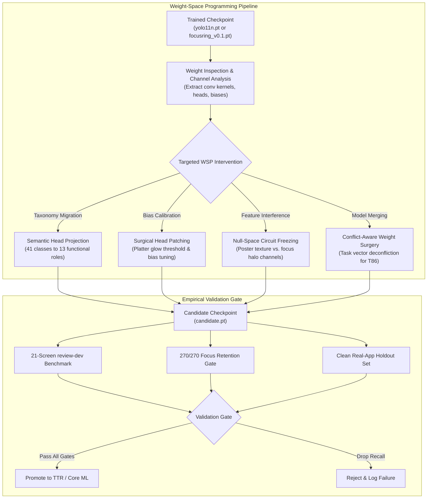

# ADR-0033 - Weight-Space Programming for UI Detection and Focus Models

Date: 2026-11-02  
Status: Proposed; architecture decision record. [Tasks.md](file:///Volumes/training-drive/data/NUIAK/project/NativeUIAuditKit/Tasks.md) owns execution status.  
Owners: `Maximum-mini-NUIAK` owns model architectures, weight transformations, and evaluation. `BigDog-NUIAK` owns distributed weight analysis and compute.  
References: [Nov2-WorkflowAnalysis.md](file:///Volumes/training-drive/data/NUIAK/project/NativeUIAuditKit/Research/Nov2-WorkflowAnalysis.md), [ADR-0032](file:///Volumes/training-drive/data/NUIAK/project/NativeUIAuditKit/Research/ADR-0032-Real-App-Grounded-Tuning-and-Synthetic-Alignment.md), [NativeUIElementDetection.md](file:///Volumes/training-drive/data/NUIAK/project/NativeUIAuditKit/Research/NativeUIElementDetection.md), [ROLES559](file:///Volumes/training-drive/data/NUIAK/project/NativeUIAuditKit/Research/Plans/Roles559.md), and Takehi et al. (MIT CSAIL, Nov 2, 2026; *Sparks of Weight-Space Programming*).

---

## 1. Context

NativeUIAuditKit uses two primary computer vision architectures:
1. `yolo11n`: an anchor-free object detector for native Apple TV UI elements.
2. `MobileNetV4ConvSmall`: a binary image classifier for UI element focus detection ([FocusRing](file:///Volumes/training-drive/data/NUIAK/project/NativeUIAuditKit/Sources/NativeUIAuditKit/FocusRingClassifier.swift)).

Training small models on niche edge cases often causes catastrophic forgetting.
For example, fine-tuning `yolo11n` on dark-theme cards can drop detection recall on light-theme buttons.
Fine-tuning `MobileNetV4ConvSmall` on platter glow often breaks historical retention on the 270 verified focus cases.
Furthermore, changing taxonomies (such as migrating from 41 classes to 13 functional roles in [ROLES559](file:///Volumes/training-drive/data/NUIAK/project/NativeUIAuditKit/Research/Plans/Roles559.md)) discards trained classification head weights.
Standard transfer learning randomly initializes these head weights, which requires extensive gradient training to recover basic class boundaries.

On November 2, 2026, researchers at MIT CSAIL published *Sparks of Weight-Space Programming* (Takehi, Teoh, Zhang, and Khattab).
The paper demonstrated that frontier reasoning models can inspect raw neural network weight matrices directly.
The models can deduce layer roles without documentation.
They can write functional mini-networks from scratch without gradients.
Crucially, they can perform surgical weight editing on a tiny fraction of weights (for example, 0.016% of parameters) to resolve specific failure loops.

We need an architectural decision on how to adapt Weight-Space Programming (WSP) techniques to NativeUIAuditKit.
We must accelerate model adaptation while preserving hard-won baseline capabilities.

---

## 2. Decision

We decide to adopt Weight-Space Programming as an offline diagnostic, weight surgery, and head initialization tool.
WSP operates alongside standard backpropagation training.
We do not use WSP to bypass empirical evaluation.
Every modified weight tensor is treated as an unverified candidate model (`candidate.pt`).
The candidate must pass the full isolated validation suite before admission.

### 2.1. Use Case 1: Semantic Head Projection for Taxonomy Migration
When migrating `yolo11n` from 41 classes to 13 functional roles ([ROLES559](file:///Volumes/training-drive/data/NUIAK/project/NativeUIAuditKit/Research/Plans/Roles559.md)):
1. Do not initialize the new classification head (`cv3`) with random weights.
2. Read the trained 41-class output projection matrix.
3. Map source channels to destination channels using semantic grouping rules.
   For example, combine weights for `primaryButton`, `secondaryButton`, and `segmentedButton` into the single `button` role.
4. Scale combined weight vectors by prior class activation frequencies.
5. Initialize the 13-role head with these projected weights before running gradient fine-tuning.
This warm-start preserves learned feature extractors and eliminates early training instability.

### 2.2. Use Case 2: Surgical Head Patching for Threshold and Platter Calibration
The `MobileNetV4ConvSmall` focus classifier terminates in a `1x1` convolution or linear layer (`Conv2d(960, 1)`):
1. When real-app evaluation exposes systematic under-confidence on specific platter styles (such as NewsTV pills), inspect the final projection weights and bias scalar.
2. Calculate the activation delta for false negatives on `review-dev`.
3. Apply surgical offsets to the output bias and relevant channel weights without modifying backbone layers.
4. If the surgical patch recovers false negatives while preserving all 270 historical focus cases, admit the patch.
This direct adjustment avoids full-network backpropagation that risks catastrophic forgetting.

### 2.3. Use Case 3: Mechanistic Circuit Auditing for Focus vs. Texture Interference
In apps like Swiftfin, high-contrast poster artwork contains edges that trigger false focus detections:
1. Extract kernel weights from the inverted residual blocks of `MobileNetV4ConvSmall`.
2. Identify channels with high gradient activation on high-frequency artwork textures versus low-frequency platter halos.
3. Use weight-space projection to nullify texture-sensitive channels in the final classification projection.
4. Verify that background poster crops score below 0.05 confidence while focused controls remain above 0.85 confidence.

### 2.4. Use Case 4: Conflict-Aware Model Merging (T86 Enhancement)
Template `T86` merges checkpoints using Fisher information and weight interpolation:
1. Standard linear interpolation fails when two task vectors contain opposing parameter updates.
2. Use weight-space inspection to identify directional conflicts in corresponding weight matrices.
3. Nullify or orthogonalize conflicting parameter coordinates before computing the final weight sum.
4. Re-calibrate BatchNorm running statistics using training-only synthetic batches.

---

## 3. Strict Safety and Qualification Boundaries

1. **No Unverified Admissions**:
   A weight-space edit is an unverified hypothesis.
   Do not promote any model without passing all standard empirical benchmarks.
2. **Mandatory Retention Gates**:
   Candidate focus models must pass 270 of 270 historical focus cases.
   Candidate detector models must retain all baseline detections on `review-dev`.
3. **Immutability of Baseline Weights**:
   Preserve unmodified baseline weights (`baseline.pt`) before applying weight surgery.
   Always maintain an exact rollback path.
4. **Machine Ownership**:
   `Maximum-mini-NUIAK` executes local weight inspections and candidate evaluations.
   `BigDog-NUIAK` executes large-scale parameter audits and distributed search tasks.

---

## 4. Consequences

### Positive Consequences
- **Zero-Shot Head Migration**: Accelerates convergence when reducing or restructuring class taxonomies.
- **Protection Against Catastrophic Forgetting**: Surgical head edits isolate adjustments to output layers, preserving backbone feature representations.
- **Explainable Model Diagnostics**: Weight inspections identify which channels cause false positives on high-contrast backgrounds.
- **Reduced Training Compute**: Targeted parameter updates can fix localized threshold bugs in seconds without 30 epochs of training.

### Negative Consequences and Tradeoffs
- **Tooling Complexity**: Requires custom weight extraction and tensor manipulation scripts in `scripts/`.
- **Architecture Specificity**: Weight manipulation rules for `MobileNetV4ConvSmall` do not apply directly to `yolo11n` convolution heads.
- **Validation Discipline**: Developers must maintain strict testing discipline to prevent unverified weight patches from leaking into release candidates.

---

## 5. Rejected Alternatives

1. **Directly Shipping Model Weights Edited by LLMs Without Benchmark Evaluation**:
   Rejected. Unverified weight edits can introduce silent regressions on edge cases. All weights require empirical qualification.
2. **Replacing Backpropagation Entirely with Weight-Space Writing**:
   Rejected. Complex multi-scale feature extractors in deep backbones require gradient optimization on pixel data.
3. **Relying Solely on Full Retraining for Minor Head Biases**:
   Rejected. Full backpropagation for localized platter glow issues regularly causes catastrophic forgetting on baseline focus sets.

---

## 6. Implementation and Verification Plan

1. **Script Implementation**:
   Develop `scripts/wsp_head_projection.py` to map 41-class YOLO heads to 13-role heads.
   Develop `scripts/wsp_focus_patch.py` to inspect and calibrate `MobileNetV4ConvSmall` output bias and head weights.
2. **Isolated Unit Testing**:
   Write unit tests in [Tests/NativeUIAuditKitTests/](file:///Volumes/training-drive/data/NUIAK/project/NativeUIAuditKit/Tests/NativeUIAuditKitTests/) to verify weight tensor shapes, projection matrix ranks, and numerical stability.
3. **Empirical Gate Verification**:
   Evaluate candidate weights on `review-dev` (21 frames) and the 270-case FocusRing suite.
   Log precision, recall, and retention deltas in [ExperimentLog.md](file:///Volumes/training-drive/data/NUIAK/project/NativeUIAuditKit/Research/ExperimentLog.md).
4. **Core ML Conversion**:
   Export verified candidate weights to Core ML using existing export tools.
   Confirm runtime inference parity on tvOS Simulators.
