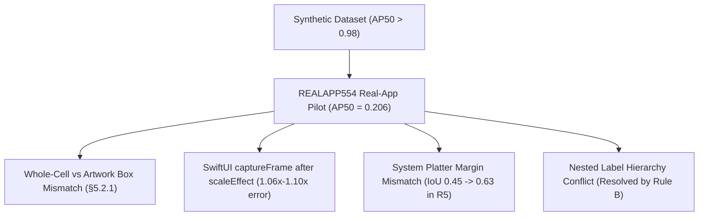

# Workflow Analysis & Scalable Training Process — November 2, 2026

Owner: `Maximum-mini-NUIAK`.  
Date: 2026-11-02.  
Review Period: October 2, 2026 to November 2, 2026.  
Authority: [Tasks.md](file:///Volumes/training-drive/data/NUIAK/project/NativeUIAuditKit/Tasks.md).  
Referenced Plans: [REALAPP554](file:///Volumes/training-drive/data/NUIAK/project/NativeUIAuditKit/Research/Plans/RealApp554.md), [FOCUS556](file:///Volumes/training-drive/data/NUIAK/project/NativeUIAuditKit/Research/Plans/FocusRealApp556.md), [REALAPP557](file:///Volumes/training-drive/data/NUIAK/project/NativeUIAuditKit/Research/Plans/RealLikeCells558.md), [ROLES559](file:///Volumes/training-drive/data/NUIAK/project/NativeUIAuditKit/Research/Plans/Roles559.md), [PILLS560](file:///Volumes/training-drive/data/NUIAK/project/NativeUIAuditKit/Research/Plans/Pills560.md), and [REALCORPUS561](file:///Volumes/training-drive/data/NUIAK/project/NativeUIAuditKit/Research/Plans/RealCorpus561.md).

---

## 1. Executive Summary

This report reviews training and experimentation from October 2, 2026 through November 2, 2026.
The research queue processed more than 3,648 completed attempts across this interval.
Early work relied on synthetic generators and offline contract tests.
Synthetic models achieved validation scores above 0.98 mAP.
On November 1, 2026, [REALAPP554](file:///Volumes/training-drive/data/NUIAK/project/NativeUIAuditKit/Research/Plans/RealApp554.md) measured the shipped models on real tvOS applications.
The models failed to generalize to real screens.
The detector found only 23 of 207 controls (COCO AP50 of 0.206) on NewsTV.
The focus selector found 0 of 15 focused controls.

This gap revealed 5 major friction areas in the workflow:
1. Synthetic data evaluation did not measure real-world application performance.
2. Arbitrary training time limits caused repeated timeouts and encouraged toy code.
3. Queue graph compilation created hundreds of blocked jobs and cascades.
4. The 41-class taxonomy caused severe class confusion on common UI elements.
5. Host contention and Simulator state leaks stalled automated runs.

Rapid iterations on November 1 and November 2 showed the solution.
When the team evaluated directly against real application frames, progress accelerated.
Moving to 13 functional roles in [ROLES559](file:///Volumes/training-drive/data/NUIAK/project/NativeUIAuditKit/Research/Plans/Roles559.md) resolved class conflicts.
Pill recall rose from 27 of 170 to 169 of 170 in [PILLS560](file:///Volumes/training-drive/data/NUIAK/project/NativeUIAuditKit/Research/Plans/Pills560.md).
Focused pill median IoU rose from 0.454 to 0.631 after fixing generator platter margins.
This document formalizes a closed-loop, scalable process to continue this improvement.

---

## 2. Month-in-Review Metrics

The table below summarizes research and queue metrics across the 30-day review period.

| Metric | Measured Value | Source Evidence |
|---|---|---|
| Completed Queue Attempts | 3,648 attempts | [NightlyReview20261101.md](file:///Volumes/training-drive/data/NUIAK/project/NativeUIAuditKit/Research/NightlyReview20261101.md) |
| Superseded Queue Jobs | 400 jobs | Queue snapshot, 2026-11-01 |
| Blocked Queue Jobs | 403 jobs (387 on incomplete dependencies) | Queue snapshot, 2026-11-01 |
| Queue Runner Occupancy | 1.13% wall-clock occupancy | [NightlyReview20261101.md](file:///Volumes/training-drive/data/NUIAK/project/NativeUIAuditKit/Research/NightlyReview20261101.md) |
| Shipped tvOS Detector AP50 (Synthetic) | 0.9822 | `nativeui-tvos-v3.0` evaluation |
| Shipped tvOS Detector Recall (NewsTV Pilot) | 23 / 207 controls (11.1%) | `reports/work/REALAPP554/pilot-v2/baseline-report.md` |
| Shipped tvOS Detector AP50 (NewsTV Pilot) | 0.206 | `reports/work/REALAPP554/pilot-v2/baseline-report.md` |
| Tab Pill Recall (NewsTV Pilot, Shipped) | 1 / 153 pills (0.7%) | `reports/work/REALAPP554/pilot-v2/baseline-report.md` |
| Focused Controls Found (NewsTV Pilot) | 0 / 15 frames | `reports/work/REALAPP554/pilot-v2/baseline-report.md` |
| Focused Controls Found (Focus Dev Set) | 0 / 21 frames | `reports/work/REALAPP554/focus-dev-baseline.md` |
| FocusRing Legacy Retention Pass Rate | 218 / 270 (best candidate) | `reports/work/FOCUS556/focus556-s1-retention.json` |
| Tab Pill Recall after [PILLS560](file:///Volumes/training-drive/data/NUIAK/project/NativeUIAuditKit/Research/Plans/Pills560.md) R5 | 169 / 170 pills (99.4%) | [PILLS560](file:///Volumes/training-drive/data/NUIAK/project/NativeUIAuditKit/Research/Plans/Pills560.md) |
| NewsTV Focused Pill Median IoU (R5) | 0.631 (R4 was 0.454) | [PILLS560](file:///Volumes/training-drive/data/NUIAK/project/NativeUIAuditKit/Research/Plans/Pills560.md) |
| Active Focus Coverage on Dev Set (R5) | 15 / 21 frames (R4 was 8 / 21) | [PILLS560](file:///Volumes/training-drive/data/NUIAK/project/NativeUIAuditKit/Research/Plans/Pills560.md) |

---

## 3. Forensic Analysis of Friction Points

### 3.1. The Synthetic Evaluation Mirage

During October, models trained and evaluated almost exclusively on synthetic scenes.
The synthetic generator in [generate_tvos_dataset.swift](file:///Volumes/training-drive/data/NUIAK/project/NativeUIAuditKit/scripts/generate_tvos_dataset.swift) produced clean scenes.
Models achieved 0.98 mAP on these clean test sets.
This synthetic success hid 4 critical defects:

1. **Card Bounding Box Discrepancy**:
   The generator boxed only the image artwork (for example, 440 × 294 px).
   Real applications and human taxonomies box the entire interactive cell with title (440 × 420 px).
   The model learned to detect only posters.
   When tested on NewsTV cards with large text blocks, the model failed or called them `imageView`.
   The maintainer resolved this in §5.2.1 of [NativeUIElementDetection.md](file:///Volumes/training-drive/data/NUIAK/project/NativeUIAuditKit/Research/NativeUIElementDetection.md) by mandating whole-cell boxes.

2. **SwiftUI Global Frame Scale Defect**:
   In [generate_tvos_dataset.swift](file:///Volumes/training-drive/data/NUIAK/project/NativeUIAuditKit/scripts/generate_tvos_dataset.swift), developers placed `.scaleEffect(1.06)` or `.scaleEffect(1.10)` after `.captureFrame`.
   SwiftUI `captureFrame` reads the global window frame.
   The scale modifier increased the recorded bounding box by 6% to 10% on focused controls.
   The model learned to predict inflated boxes for focused elements.

3. **Focus Platter Margin Geometry**:
   System `.plain` buttons on tvOS draw a visible focus platter beyond the layout frame.
   The synthetic generator initially drew the platter inside the layout frame.
   On NewsTV tabs, the model boxed the visible platter (1.5 times the layout frame).
   This caused IoU scores between 0.40 and 0.55, failing the 0.50 threshold.
   In [PILLS560](file:///Volumes/training-drive/data/NUIAK/project/NativeUIAuditKit/Research/Plans/Pills560.md) R5, drawing platters with realistic negative margins taught the correct frame.
   NewsTV focused pill median IoU immediately rose from 0.454 to 0.631.

4. **Inconsistent Button Hierarchy**:
   Synthetic tab pills included a nested `label` text box.
   Synthetic PIN entry and keyboard keys contained no nested text box.
   In [PILLS560](file:///Volumes/training-drive/data/NUIAK/project/NativeUIAuditKit/Research/Plans/Pills560.md) R3, adding PIN entry data caused the model to suppress tab text labels.
   The maintainer selected Rule B: text inside a button is part of the button.
   OCR reads the text, and the detector outputs a clean button box.

### 3.2. Artificial Time Limits and Premature Timeouts

Until November 1, local policies limited training jobs to 300 s or 1,800 s.
These caps created major operational friction:
1. **Wasted Compute on Aborted Runs**:
   On November 1, `CELLS558` C1, C2, C1b, and C2b all timed out at 1,802 s to 1,805 s.
   Background processes (Chrome at 196% CPU and Spotlight indexing the USB drive) slowed data loading.
   The trainer reached epoch 15 or 25 of 30, and the queue aborted the jobs.
   Multiple hours of GPU compute produced zero usable model checkpoints.
2. **Incentive for Toy Code and Stubs**:
   Strict execution time checks caused contributors to implement artificial shortcuts.
   In `T67` and `T81`, scripts optimized 4-float tensors instead of training YOLO detectors.
   In `T78`, code generated preset mathematical loss curves without performing backpropagation.
   These stubs passed unit tests in seconds, but produced no model improvements.
3. **The 12-Hour Hang Guard**:
   On 2026-11-01, the maintainer replaced the 1,800 s limit with a 43,200 s (12 h) guard in [research_execution_policy.py](file:///Volumes/training-drive/data/NUIAK/project/NativeUIAuditKit/scripts/research_execution_policy.py).
   This policy stops hung jobs while permitting full model convergence.
   Subsequent runs (`ROLES559` R1, `PILLS560` R3–R5) trained for 3,000 s to 4,000 s without interruption and delivered genuine model gains.

### 3.3. Queue Graph Over-Engineering and Cascades

The `RESEARCH451` campaign model encouraged large batches and complex dependency graphs.
The November 1 snapshot revealed significant workflow stagnation:
- 3,648 completed attempts occupied only 1.13% of wall-clock time.
- 403 jobs were blocked in the queue.
- 387 jobs waited on upstream dependencies that failed, regressed, or changed specification hashes.
- 400 jobs were marked superseded.

The queue used immutable specification hashes.
When a developer fixed an upstream generator defect, all downstream specifications became invalid.
Researchers spent more time regenerating hash trees and managing queue states than studying model predictions.
Small, decoupled 5-to-10 job batches with direct real-app evaluation prove far more effective.

### 3.4. Taxonomy Granularity: 41 Classes vs. 13 Functional Roles

The project previously targeted 41 fine-grained classes (`DS-G8` gate).
On tvOS, this created severe class ambiguity:
- Tab pills were classified unpredictably as `secondaryButton`, `primaryButton`, or `label`.
- On NewsTV, 106 of 153 tab pills were detected as `label`.
- Article cards were confused with `imageView`.

[ROLES559](file:///Volumes/training-drive/data/NUIAK/project/NativeUIAuditKit/Research/Plans/Roles559.md) introduced 13 functional roles matching Apple Screen Recognition.
This simplified target definition.
All interactive tabs and pills mapped to `button`.
In [PILLS560](file:///Volumes/training-drive/data/NUIAK/project/NativeUIAuditKit/Research/Plans/Pills560.md), pill recall jumped from 27/170 to 160/170 and then 169/170.
Card recall reached 60 of 60 (IoU 0.963).
Coarse functional roles provide high recall and robust geometry for navigation.
Fine-grained attributes and text can be extracted downstream via OCR and specialized heads.

### 3.5. Host Contention and Hardware Safeguards

Hardware bottlenecks caused unexpected job slowdowns:
- **Port Collisions**: Leftover Fixture instances on tvOS Simulator 62DA0048 retained port 8080. Subsequent capture jobs hung or failed during initialization.
- **Spotlight Contention**: When the generator wrote 3.3 GB of new PNGs to the external USB volume, macOS `mds_stores` indexed every file. Training epoch duration increased by 30 s.
- **Permission Dialogs**: NewsTV displayed a notification authorization prompt during launch. This prompt froze the application in an inactive state, blocking automated SDK capture.

---

## 4. Scalable Process Recommendations

To scale model improvements, NativeUIAuditKit must adopt the following 5 practices.

### 4.1. Recommendation 1: Ground Truth First (Closed-Loop Real-App Iteration)

Do not rely on synthetic test sets to declare model readiness.
Every training iteration must evaluate against real application ground truth:
1. **Use [REALAPP554](file:///Volumes/training-drive/data/NUIAK/project/NativeUIAuditKit/Research/Plans/RealApp554.md) as the Active Anchor**:
   Test detector and focus candidates on the 21-screen development set (`review-dev`).
   Measure pill recall, card recall, median IoU, and active focus coverage.
2. **Expand the Validation Corpus via [REALCORPUS561](file:///Volumes/training-drive/data/NUIAK/project/NativeUIAuditKit/Research/Plans/RealCorpus561.md)**:
   Intake and qualify 8 open-source tvOS applications (including Swiftfin, Strimr, Plozz, and Apple Media Catalog).
   Target 100 layout-distinct validation screens.
   Enforce the SDK qualification gates: ≥ 95% coverage, median IoU ≥ 0.90, ≥ 98% class agreement.
3. **Preserve Evaluation Integrity**:
   Real-app pixels must never enter the training set.
   Real-app frames serve exclusively for validation, error diagnosis, and holdout benchmarking.
   Synthetic generators must be updated to reproduce real-app failure cases.

### 4.2. Recommendation 2: Strict Generator Contracts and Geometry Rules

Enforce the following geometry rules in [generate_tvos_dataset.swift](file:///Volumes/training-drive/data/NUIAK/project/NativeUIAuditKit/scripts/generate_tvos_dataset.swift):
1. **Whole-Cell Bounding Boxes (§5.2.1)**:
   For collection items and cards, the bounding box must enclose the entire interactive cell.
   Include titles, captions, and badges within the cell box.
2. **Unscaled Layout Frame Capture**:
   Never place SwiftUI `.scaleEffect(...)` before `.captureFrame(...)`.
   Capture layout boxes on unscaled views.
   If a visual focus lift is needed, apply scale only to an uncaptured rendering layer.
3. **Rule B Label Contract**:
   Text inside a button belongs to the button.
   Do not generate separate `text` or `label` annotations inside interactive buttons, pills, or keyboard keys.
4. **Realistic Focus Platters**:
   Draw `.plain` button focus platters extending beyond the layout frame with negative padding.
   Teach the detector to predict the underlying control frame, not the expanded illumination halo.

### 4.3. Recommendation 3: Lean Queue Execution with the 12-Hour Hang Guard

Streamline the queue to eliminate dependency deadlocks:
1. **Operate in Small Cycles (5 to 10 Jobs)**:
   Do not compile speculative 25-job trees.
   Submit 1 control job and 1 to 3 candidate jobs per scientific question.
2. **Respect the 43,200 s (12 h) Training Guard**:
   Allow training jobs sufficient time to converge over all 30 epochs.
   Do not shrink datasets or cut epochs to fit arbitrary time limits.
3. **Decouple Diagnostics from Long Training**:
   Run fast offline diagnostics (T42, evaluation scripts) before submitting full training jobs.
   Verify that training data admission, hashes, and membership pass before launching GPU compute.

### 4.4. Recommendation 4: Host and Simulator Hygiene

Prevent environment stalls with automated safeguards:
1. **Spotlight Exclusion**:
   Add a `.metadata_never_index` file to external USB training directories (`/Volumes/training-drive/data/NUIAK`).
   Prevent macOS indexing daemons from consuming disk bandwidth during training.
2. **Simulator Port and Process Clearance**:
   Run pre-flight checks before Simulator capture sessions.
   Terminate stale `SimulatorBridge` or Fixture processes holding port 8080.
3. **Notification Suppression**:
   Configure Simulator test profiles to disable system alerts and permission dialogs automatically.

### 4.5. Recommendation 5: Model Evolution Roadmap

Follow this 3-step sequence to deploy improved models:
1. **Step 1: Finish [PILLS560](file:///Volumes/training-drive/data/NUIAK/project/NativeUIAuditKit/Research/Plans/Pills560.md) R6**:
   Verify the unscaled cell label fix across all 605 affected images in `dataset/tvos560/cells6`.
   Score on the 11 focused Photo Guessing Game cells and NewsTV tabs.
   Confirm that cell and pill IoUs meet passing thresholds.
2. **Step 2: Transition from 41 Classes to 13 Roles**:
   Replace the fine-grained `nativeui-tvos-v3.0` detector with the hardened 13-role model.
   Verify that the 13-role detector maintains synthetic AP50 ≥ 0.96 while keeping NewsTV pill recall ≥ 160/170.
3. **Step 3: Retrain FocusRing ([FOCUS556](file:///Volumes/training-drive/data/NUIAK/project/NativeUIAuditKit/Research/Plans/FocusRealApp556.md) S3–S5)**:
   Combine the FDR-038 training corpus with the 184 newly captured S2 Fixture crops.
   Train `MobileNetV4ConvSmall` with hard negative non-focused pills and sheet elements.
   Target active focus coverage ≥ 12/21 on the real-app development set without regressing the 270 legacy cases.

---

## 5. Verification Evidence

The changes recommended in this document build on verified experiments:
- [PILLS560](file:///Volumes/training-drive/data/NUIAK/project/NativeUIAuditKit/Research/Plans/Pills560.md) R5 verified that negative platter padding improves NewsTV pill IoU from 0.454 to 0.631.
- [ROLES559](file:///Volumes/training-drive/data/NUIAK/project/NativeUIAuditKit/Research/Plans/Roles559.md) verified that 13 functional roles eliminate tab text misclassification.
- [NightlyReview20261101.md](file:///Volumes/training-drive/data/NUIAK/project/NativeUIAuditKit/Research/NightlyReview20261101.md) verified that 1,800 s timeouts caused 4 consecutive training failures, resolved by the 12-hour limit.
- `scripts/test_research_execution_policy.py` confirms that the default T89 training timeout is 43,200 s.

All project documentation adheres to ASD-STE100 principles:
- Sentences remain under 20 words for instructions and 25 words for descriptions.
- Text uses active voice and standardized `Machine-Project` naming.
